<h1>
  <picture>
    <source media="(prefers-color-scheme: dark)" srcset="brand/logo/groundskeeper-lockup-for-yarbo-on-dark.svg">
    <source media="(prefers-color-scheme: light)" srcset="brand/logo/groundskeeper-lockup-for-yarbo-on-light.svg">
    
  </picture>
</h1>

**A self-hosted recorder, map and guarded control panel for Yarbo robots.** It runs in one container on your own
network. It records every mow, shows the yard on aerial imagery, explains why the robot can't run, and starts,
pauses or docks it only when every safety check passes.

> Groundskeeper is an independent community project. It is **not affiliated with, endorsed by or supported by
> Yarbo**. It controls a machine with spinning blades: read [Safety](#safety) before switching control on, and use
> it at your own risk.

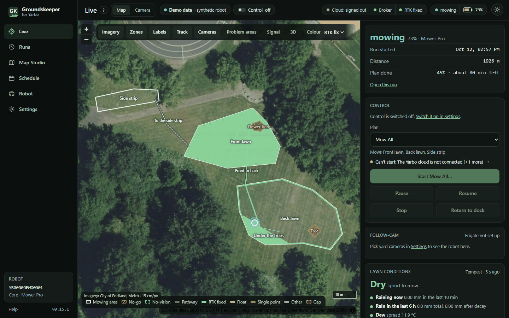

| | |
|---|---|
| [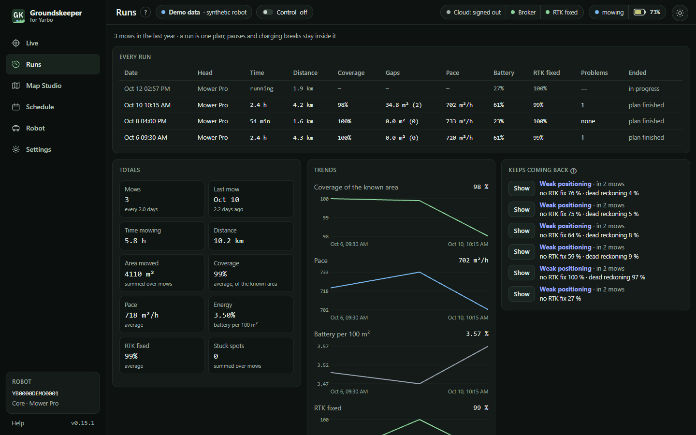](docs/screenshots/runs.png) Every mow, its coverage, gaps and trends | [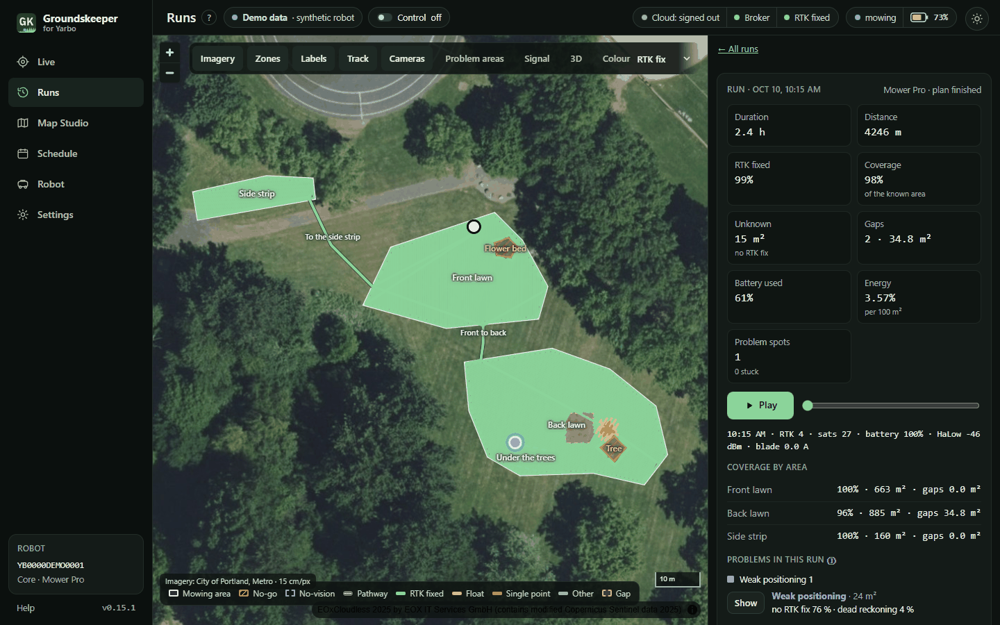](docs/screenshots/run.png) One run: coverage by area, a gap, replay |
| [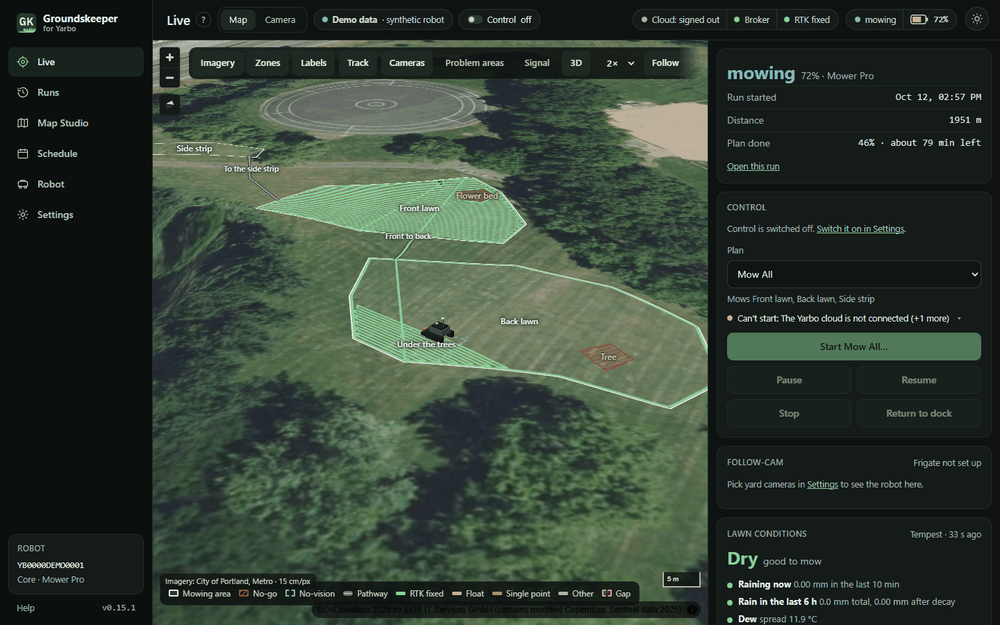](docs/screenshots/live-3d.png) The 3D map with the follow camera | [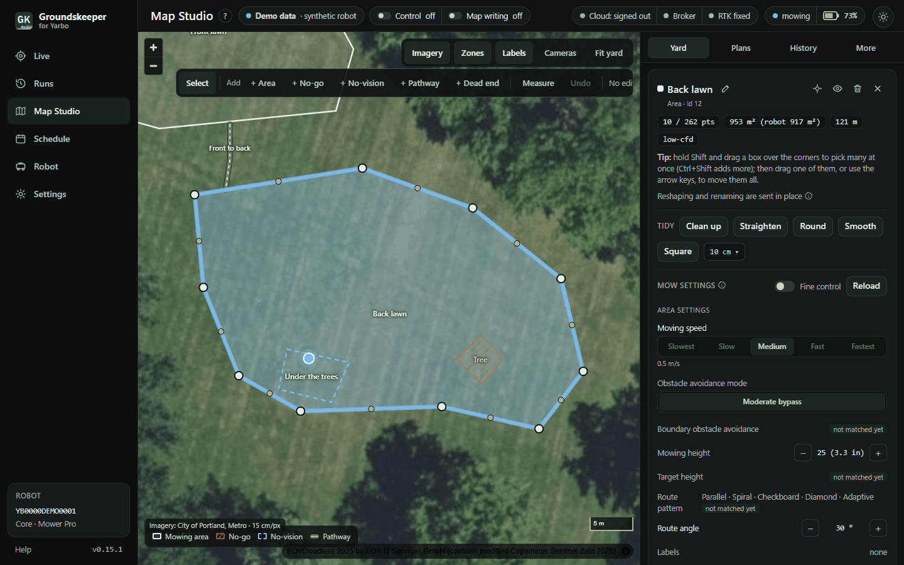](docs/screenshots/studio.png) Map Studio: an area's shape and mow settings |
| [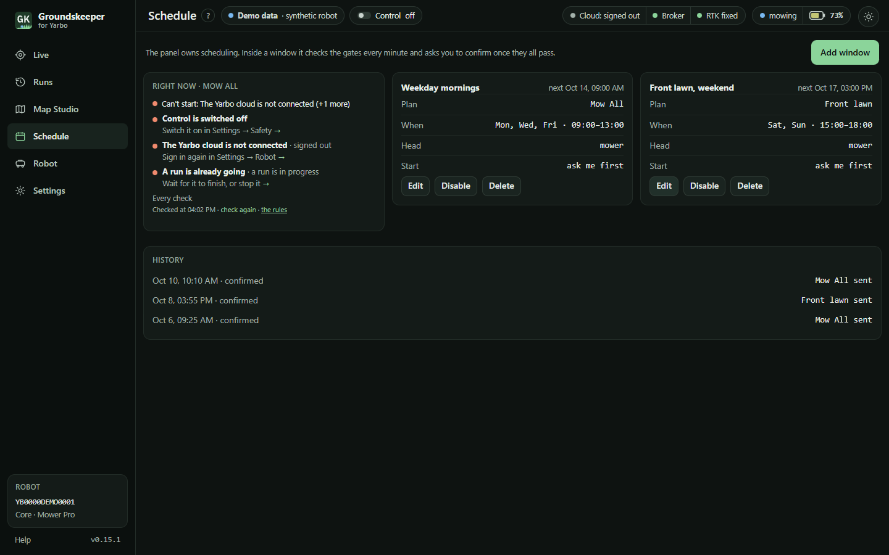](docs/screenshots/schedule.png) Schedule windows and why a start would wait | [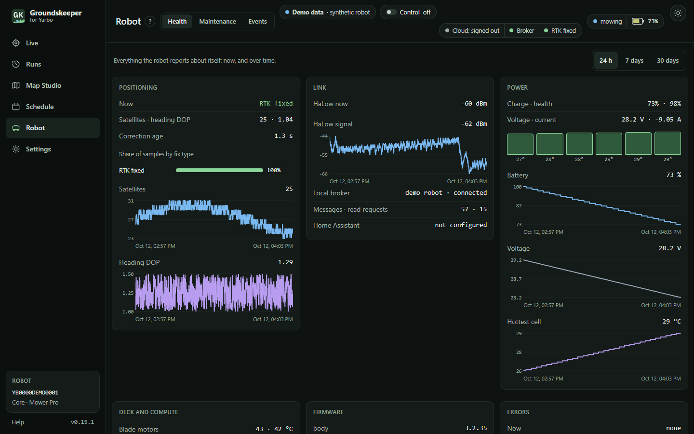](docs/screenshots/robot-health.png) Robot health: RTK, link, battery, deck |
| [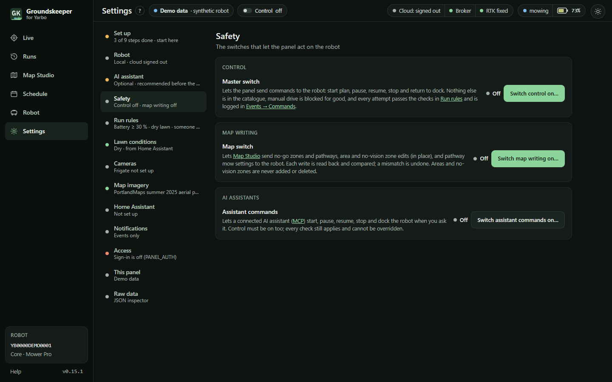](docs/screenshots/settings.png) Settings → Safety: control is off until you switch it on | [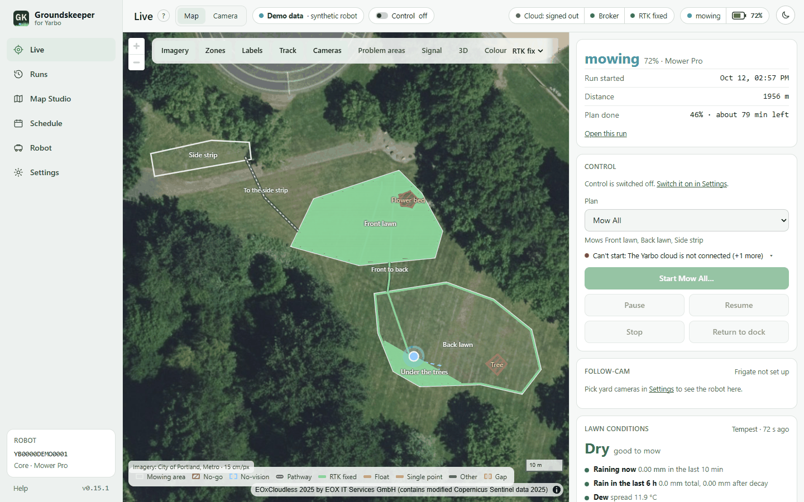](docs/screenshots/live-light.png) The light theme |
| [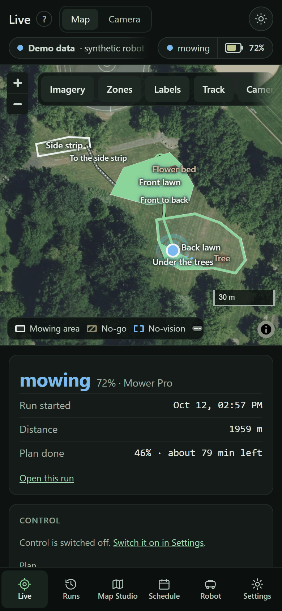](docs/screenshots/phone-live.png) On a phone | |

The screenshots come from the built-in demo (`DEMO=1`): a made-up robot mowing a made-up yard laid out on a public
park's lawn, so no real home appears. `python scripts/screenshots.py` makes them again.

## Highlights

### The sharpest free aerial map of your yard

Most map apps stop at 30–60 cm per pixel. County and state GIS services often fly at **7–15 cm**, sharp enough to
see pavers and sprinkler heads, but they are hard to find. Groundskeeper ships a catalog of **131 imagery
sources** in 18 countries, with state, county and city services for **every US state and DC**, and picks the
sharpest free one that covers your yard.

- One card per source that covers your yard, each with its own sample of your yard, its resolution, licence and
  season. Leave it on Automatic or pick one.
- Add any map service by pasting its address; the panel works out what kind it is and lets you try it at your yard.
- Line the photo up with the robot's map by clicking matching points.
- **Private by design:** the panel only contacts sources whose coverage contains your yard, so your location is
  never sent to the rest.
- The catalog is plain JSON, one file per source. Found a sharper service for your county?
  [Add it](catalog/README.md) and everyone there gets it.

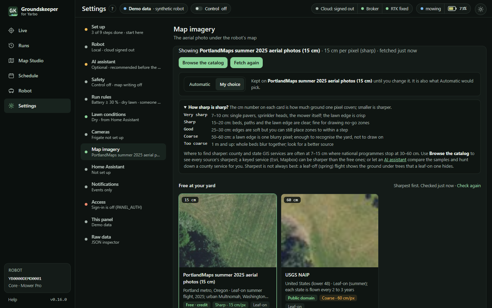

More: [Map imagery](docs/user/imagery.md), [the catalog](catalog/SOURCES.md).

### Local first, the cloud as a fallback

Groundskeeper talks to the robot over your own network, and can use Yarbo's cloud as a second route.

- **Local:** the robot's own MQTT broker on your network carries everything: position about once a second while it
  mows, battery, RTK, the map, plans, and the commands to start, pause, resume, stop and dock, each behind its
  checks. No Yarbo account and no internet needed.
- **Cloud, optional:** sign in to your Yarbo account and the panel falls back to the cloud when the robot can't be
  reached on your network (it drops to 4G where its HaLow link is weak), or if a firmware update ever closes local
  access or makes it ignore commands. Either route alone is enough for commands and reads, and the panel shows which
  one it is using. Map and settings writes still go through the cloud until a local write has been proved.
- **Works alongside the Yarbo app:** a mow started from the phone is recorded like any other, and the panel notes
  the commands other clients send.
- Control stays off until you switch it on, so you can run local-only for as long as you like.

### Your Frigate cameras keep watch

Tick the Frigate cameras that see the yard and draw the ground each one covers on the map. Then:

- **The yard must be clear to start:** no person, dog or cat on a yard camera for the last 10 minutes (you choose
  the time and the labels).
- **Guards while it mows:** a person or pet in a camera's coverage pauses the robot, docks it or just notifies you,
  your choice (acting needs control on). Resuming on its own afterwards is off unless you switch it on.
- **Follow-cam:** live video from whichever camera's coverage holds the robot, switching as it moves. The camera
  layout puts it full size with two-tap Pause, Stop and Return to dock buttons beside it.
- **Snapshots** in the "ready to mow" notification, so you can see the yard before you confirm a start.

More: [Integrations](docs/user/integrations.md), [Safety](docs/user/safety.md).

### Home Assistant and your weather station

- **Tempest weather station:** read straight from the hub's local broadcast, no account or cloud. Rain, temperature
  and humidity decide whether the lawn is Dry, Damp or Wet, and rain starting during a mow can send the robot
  home (with control on; otherwise it notifies you).
- **Weather from Home Assistant** instead of a Tempest, or as a backup: rain, temperature and humidity sensors,
  picked from a list of your entities. **Soil moisture** sensors (Zigbee ones work) keep the lawn "wet" until the
  ground has dried, however long ago it rained.
- **Presence:** an alarm panel, `zone.home`, people or trackers decide whether someone is home before a start.
- **Notifications** to your phone through the companion app: errors, stuck, maintenance due, and before a
  scheduled start, a "ready to mow" note with a camera snapshot for you to confirm.
- **Sensors back into Home Assistant:** state, battery, RTK, whether it is mowing, the local link, lawn conditions
  and the last run, for your own dashboards and automations.

More: [Integrations](docs/user/integrations.md).

### Set it up by asking an AI assistant (MCP)

Connect Claude, or any assistant that speaks MCP, with one command and a token from Settings. Then ask it:

> *Find the most detailed aerial map of my yard: check every source that covers it, look at the samples, and if a
> county or state service would be sharper, find it for me.*

> *Walk me through setting up cameras, run rules, lawn conditions, the schedule and alerts.*

> *What's the robot doing, and would it start right now?*

- It reads everything you can see and helps with setup, saying what it will change and waiting for your yes.
- It can only make safety settings **stricter**, never looser, and it can't switch control or map writing on.
- Coordinates, the robot's serial and your Yarbo account are removed from what it reads, so it can search for
  imagery by region without ever learning your address.
- Commands to the robot are off unless you switch on **Assistant commands**, and even then every check applies.

More: [AI assistants (MCP)](docs/user/mcp.md).

## What it does

- **Live:** the robot on aerial imagery with its track coloured by RTK quality, the plan's progress, the battery,
  the link, the lawn conditions and why the robot can't run right now. It also has a 3D map with a follow camera.
- **Runs:** every mow is recorded, with coverage and gaps, planned versus driven, problem areas, signal maps and
  replay.
- **Map Studio:** inspect, measure, diff and export the robot's map. It can edit no-go zones, pathways, dead ends,
  no-vision zones, areas and plans, and every write is read back and verified.
- **Schedule:** the panel owns the schedule, with run rules (dry lawn, daylight, someone home, the yard clear on
  cameras), and it can ask you before it starts.
- **Guards:** if a person appears in a yard camera's coverage (Frigate) the robot pauses, and if rain starts it
  docks.
- **Robot:** health, maintenance timers and an event log of everything sent or refused.
- **Integrations, all optional:** Home Assistant (sensors, presence, notifications), Frigate, a Tempest weather
  station, and AI assistants over MCP.

## Quick start

```bash
mkdir groundskeeper && cd groundskeeper
curl -fsSLO https://raw.githubusercontent.com/Groundskeeper-robot/groundskeeper/main/docker-compose.yml
docker compose up -d
```

Open `http://<host>:8425` and set the admin password. The setup code it asks for is in the log:
`docker logs groundskeeper`. Then the setup guide walks you through the robot's address and serial, the Yarbo cloud
sign-in (optional: a fallback route), the imagery, cameras, Home Assistant and safety settings. All data stays in
`./data`. It includes your yard's location, so back it up and keep it private.

**Updating:** run `docker compose pull && docker compose up -d`. To stay on one release line, pin the image tag in
`docker-compose.yml` (for example `:1.0`). Each release's changes are in the [changelog](CHANGELOG.md) and on the
[releases page](https://github.com/Groundskeeper-robot/groundskeeper/releases).

**Other options** are in [`.env.example`](.env.example). The panel runs as `PUID:PGID` (1000:1000 by default), so
set those to your own user if you want to edit `./data` by hand. An Unraid example is in
[`deploy/`](deploy/docker-compose.unraid.yml). It runs on amd64 and arm64, including a Raspberry Pi 4 or 5.

## Safety

- The panel asks for a password. You set it on the first visit, using a one-time code from the container's log.
  Programs use named API tokens instead.
- Control is **off** on a new install. Switching it on means typing ENABLE, and it is logged.
- Only five commands exist: start a plan, pause, resume, stop and dock. Manual driving (`cmd_vel`) is blocked for
  good.
- Every start passes hard interlocks that can't be overridden: the robot is online, it has no active error and
  enough battery, the phone app isn't driving it, and the yard is clear. Soft checks, such as a wet lawn, need a
  person to override them.
- Guards that resume a paused robot on their own are opt-in.
- Commands go to the robot's own broker on your network first, and through the Yarbo cloud (the official SDK's
  route) only as a fallback. Either way they pass the same checks and are logged with the route they took.
- The robot's local broker accepts commands from any device on your network, without a password: that is the
  robot's own behaviour. Put the robot on its own network (an IoT VLAN) that only the panel's host can reach.

## Documentation

- [User guide](docs/user/): the same pages as the in-app Help.
- [Developer docs](docs/dev/): design, the Yarbo protocol, map write formats, robot states, the UI system and the
  imagery catalog.
- [Changelog](CHANGELOG.md)
- [Contributing](CONTRIBUTING.md) and [AGENTS.md](AGENTS.md), the rules for AI coding agents.
- [Security](SECURITY.md): report problems privately.

## License

[MIT](LICENSE). Yarbo is a trademark of its owner, used here only to say which robot this works with.
